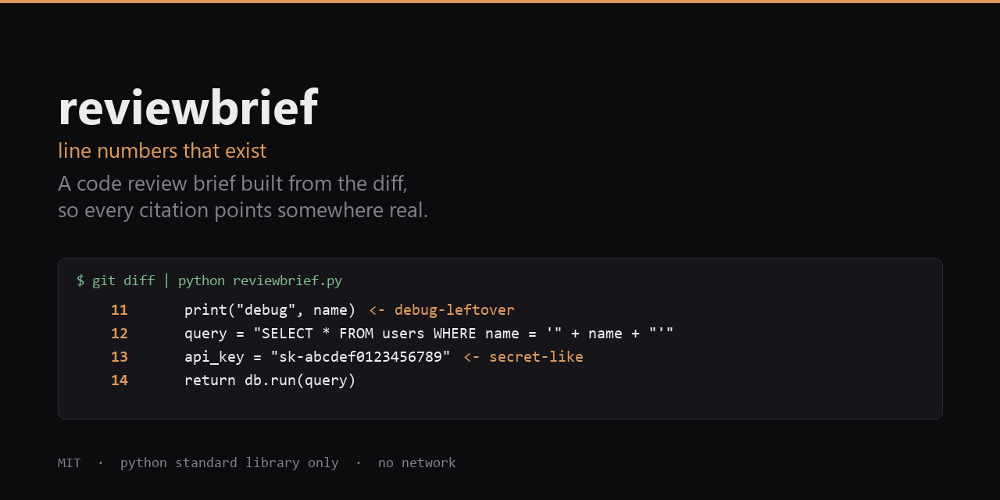

# reviewbrief

Build the brief a code reviewer actually needs, with line numbers that exist.

Every "AI code reviewer" prompt asks for specific line references. Almost none of them
give the model any line numbers to work with, so the model produces numbers that look
right and point nowhere. This fixes the input instead of asking the output to behave.

`reviewbrief` reads a unified diff and emits a review request in which every added line
is printed with its real path and line number in the new file, plus the few facts a
reviewer wants before reading: what changed, in which language, and whether any test
file moved at all.

Python standard library only. No install, no network, no dependencies.

## Use

```bash
git diff | python reviewbrief.py
git diff main...HEAD | python reviewbrief.py > review.md
python reviewbrief.py --diff saved.patch --json
```

Then paste the output into whichever reviewer you use, or pipe it to one.

| Flag | What it does |
|---|---|
| `--diff FILE` | Read the diff from a file instead of standard input |
| `--json` | Emit structured data instead of markdown |
| `--no-policy` | Emit the brief alone, without the review instructions |

Exit codes: `0` on success, `1` when the input is empty or is not a git diff, `2` when a
file cannot be read.

## What the output looks like

```
## Brief

- Files changed: 2
- Lines added: 5, removed: 1
- Languages: python, markdown
- Signals to confirm: debug-leftover x1, secret-like x1
- Changed with no matching test file in this diff: src/app.py

### src/app.py
Language: python. +4 / -1

`@@ -10,6 +10,9 @@ def handler(req):`

    11      print("debug", name)   <- debug-leftover
    12      query = "SELECT * FROM users WHERE name = '" + name + "'"
    13      api_key = "sk-abcdef0123456789"   <- secret-like
    14      return db.run(query)
```

Line 13 is line 13. A reviewer can cite it, and you can check the citation.

## The signals are not findings

Six deterministic checks run over added lines: `secret-like`, `debug-leftover`,
`todo-added`, `broad-catch`, `sleep-in-code`, and the test-coverage note.

They are regular expressions. A regular expression does not know whether your
`print(` is a leftover or the whole point of the program, and the policy that ships
with the tool says so in as many words: confirm each signal against the line, and drop
it when the line is fine. The value is in where they point, not in what they claim.

The SQL concatenation on line 12 above carries no signal, and it is the worst line in
the sample. That is the honest shape of this: the tool prepares, the reviewer decides.

## What it does not do

Merge diffs. `git show` on a merge and `git diff --cc` emit one column per parent, so
the arithmetic above does not apply. Rather than produce numbers that look right, the
tool says what it saw and exits `1`, pointing you at `git diff HEAD^1 HEAD`.

Any judgment. It prepares; it does not decide.

## The test pairing is a heuristic

A changed test counts for a source file when the source file's stem appears in the test
path, which covers `test_app.py`, `app.test.ts`, `CartTest.java` and `user_spec.rb`. It
will miss a test that covers a file without naming it, and it has no idea whether the
test is any good. It is a prompt for one sentence from the reviewer, not a coverage
number.

## Why the line numbers are the hard part

A diff hunk header says `@@ -10,6 +10,9 @@`, and from there the new-file line number
advances on added lines and on context lines, but not on removed ones. Get that wrong
and every number after the first removal is off. There is a test for it, and for the
cases that break naive parsers: renames, binary files, new and deleted files, several
hunks in one file, and `\ No newline at end of file`.

## Tests

```bash
python tests/test_reviewbrief.py
```

41 tests. Ten of them run the command line and assert on exit codes and the error
message, because a suite that only walks the happy path is measuring the author's
imagination.

## As an agent skill

`SKILL.md` is written for an agent that reads skill files. It tells the agent to run the
tool first and review from its output, instead of eyeballing the diff.

## The banner

`assets/banner.png` is drawn by `scripts/make_banner.py`, which needs Pillow. It is the
only thing here that needs anything, and nothing else imports it.

```bash
python scripts/make_banner.py assets/banner.png
```

## License

MIT. See [LICENSE](LICENSE).
